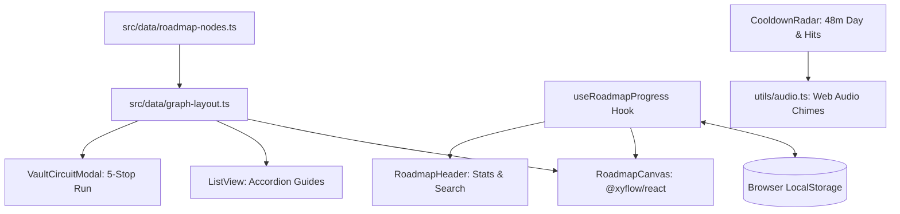

# System Architecture: `gta5online-roadmap`

## 1. System Topology & Core Concept

`gta5online-roadmap` brings the interactive node-based roadmap paradigm popularized by [roadmap.sh](https://roadmap.sh) into GTA Online. It translates 10+ years of community wealth-building knowledge (anchored on the [Reddit Mega Guide](https://www.reddit.com/r/gtaonline/comments/7ohgg5/the_gta_online_mega_guide/)) into an interactive visual graph.

---

## 2. Component Boundaries & Responsibilities

### 2.1 The Visual Graph Engine (`RoadmapCanvas.tsx` & `@xyflow/react`)
* Uses `@xyflow/react` (React Flow) to render smooth bezier and step edges, custom nodes, zoom/pan navigation, minimap, and background dots.
* Layout algorithm in `graph-layout.ts` computes coordinates based on stages (Stages 1 through 6) and multi-column grouping.
* Nodes support three interaction states:
  * Click card: Slides in the right-side detail drawer (`NodeDrawer.tsx`).
  * Click status pill: Cycles state (`To Do` $\rightarrow$ `In Progress` $\rightarrow$ `Done`).
  * Search/Filter: Dimming non-matching nodes to 20% opacity and grayscale while keeping matching nodes highlighted.

### 2.2 Slide-Over Detail Drawer (`NodeDrawer.tsx`)
* Emulates the interactive drawer from roadmap.sh.
* Renders:
  * Payout, Setup Cost, Time Investment, Solo Friendliness, and Hourly Efficiency rate.
  * Operational summary and required prerequisites.
  * Numbered step-by-step walkthrough.
  * Speedrun pro-tips and meta tricks.
  * Direct citations to Reddit guides and external resources.

### 2.3 The Real-Time Cooldown Radar (`CooldownRadar.tsx`)
* GTA Online operates on a strict **48-minute cycle** (1 in-game day = 48 real minutes).
* The Cooldown Radar tracks:
  * **GTA In-Game Day**: Continuous 48m loop indicating when all passive wall safes tick over with fresh cash.
  * **Franklin Payphone Hit**: 10-minute cooldown timer.
  * **Cayo Perico Solo Cooldown**: 144-minute timer with Hard-Mode window indicator.
  * **Tow Truck Scrap Processing**: 48-minute vehicle dismantle countdown.
  * **Agency Contract**: 5-minute cooldown.
* **Procedural Web Audio Alerts (`utils/audio.ts`)**:
  * Emits a crisp two-tone frequency chime (G5 $\rightarrow$ C6) when any timer reaches zero using the native Web Audio API (no external MP3/WAV assets, fully offline-compatible).

### 2.4 State Management & Persistence (`useRoadmapProgress.ts`)
* Uses `localStorage` key `gta_roadmap_progress_v1` to persist user milestone states across sessions.
* Triggers celebratory confetti upon marking nodes as completed.
* Computes real-time completion percentage and counts for the sticky header.
